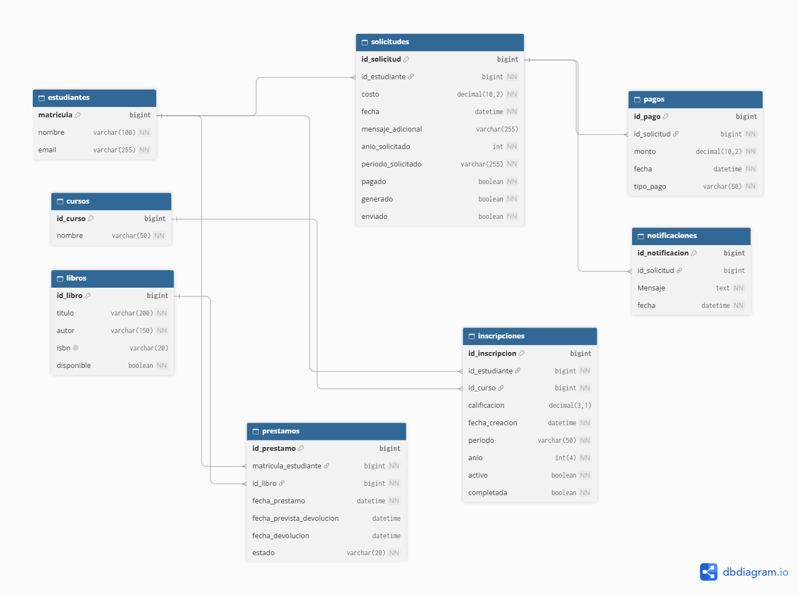

# API Constancias Universitarias (UniSOA)

API REST basada en Arquitectura Orientada a Servicios (SOA) y eventos para la gestión académica universitaria: administración de estudiantes, cursos, inscripciones/calificaciones, biblioteca/préstamos, procesamiento y validación de pagos, generación automatizada de constancias de estudio y registro de notificaciones.

Desarrollada con **Spring Boot 4**, **Spring Data JPA** y **MySQL**.

---

## Autor

**Gerardo Yeray Chelius Altamirano**  
7°B de Ingeniería en Sistemas Computacionales

---

## Diagrama de base de datos



---

## Tecnologías utilizadas

| Tecnología | Versión | Rol |
|---|---|---|
| Java | 21 | Lenguaje principal |
| Spring Boot | 4.1.1 | Framework base |
| Spring Data JPA | — | Capa de persistencia (ORM con Hibernate) |
| Spring Web MVC | — | API REST y controladores HTTP |
| Bean Validation | — | Validación declarativa de entidades |
| MySQL | 8+ | Base de datos relacional |
| MySQL Connector/J | — | Driver JDBC |
| Maven | 3.9+ | Gestión de dependencias y ciclo de vida de construcción |

---

## Requisitos previos

- **Java 21** instalado y configurado en el `PATH`.
- **MySQL 8+** en ejecución con una base de datos llamada `constancias` (o el nombre configurado en `.env`).
- **Maven 3.9+** (o utilizar el wrapper `mvnw` / `mvnw.cmd` incluido en el proyecto).

---

## Variables de entorno

La aplicación carga automáticamente las credenciales y configuración de base de datos desde un archivo `.env` ubicado en la raíz del proyecto (a través de `spring.config.import=optional:file:./.env[.properties]`).

Crea un archivo **`.env`** en la raíz del proyecto (puedes tomar como referencia `.env.example`):

```env
DB_URL=jdbc:mysql://localhost:3306/constancias?useSSL=false&allowPublicKeyRetrieval=true&serverTimezone=UTC
DB_USERNAME=tu_usuario
DB_PASSWORD=tu_contraseña
```

> **Importante:** El archivo `.env` contiene credenciales sensibles y **nunca** debe subirse al repositorio Git. Se encuentra protegido en el `.gitignore`.

| Variable | Descripción |
|---|---|
| `DB_URL` | Cadena de conexión JDBC hacia MySQL |
| `DB_USERNAME` | Usuario de MySQL |
| `DB_PASSWORD` | Contraseña de MySQL |

---

## Instalación y ejecución

### 1. Clonar el repositorio

```bash
git clone https://github.com/G-Chelius-A/UniSOA-constancias.git
cd UniSOA-constancias
```

### 2. Crear la base de datos en MySQL

Accede a tu servidor MySQL y crea la base de datos:

```sql
CREATE DATABASE constancias CHARACTER SET utf8mb4 COLLATE utf8mb4_unicode_ci;
```

### 3. Configurar las variables de entorno

Copia la plantilla `.env.example` o genera el archivo `.env`:

```bash
# Windows (PowerShell)
Copy-Item .env.example .env

# Linux / macOS
cp .env.example .env
```

Edita `.env` con tus credenciales locales de MySQL.

### 4. Compilar y ejecutar la aplicación

**Con Maven Wrapper:**

```bash
# Windows
.\mvnw.cmd spring-boot:run

# macOS / Linux
./mvnw spring-boot:run
```

**Con Maven instalado globalmente:**

```bash
mvn spring-boot:run
```

La API se iniciará en: **`http://localhost:6767`**

> **Nota:** Al inicializar, Hibernate ejecuta `spring.jpa.hibernate.ddl-auto=update`, creando o actualizando automáticamente el esquema de tablas si no existen.

---

## Flujo principal de Constancias y Eventos SOA

El sistema implementa un flujo desacoplado orientado a eventos para el trámite de constancias:

1. **Registro de Solicitud (`POST /api/solicitudes`)**:
   - Valida que el estudiante exista y cuente con cursos registrados en el período y año solicitados.
   - Evita duplicidad de solicitudes para el mismo ciclo.
   - Crea la solicitud en estado no pagada (`pagado=false`).
2. **Registro de Pagos (`POST /api/pagos`)**:
   - Se registran abonos o pagos asociados al ID de la solicitud.
3. **Confirmación de Pagos (`POST /api/solicitudes/{id}/confirmar-pagos`)**:
   - Valida que la suma de pagos cubra exactamente el costo requerido.
   - Marca la solicitud como pagada (`pagado=true`).
   - Dispara el evento desacoplado `PagoConfirmadoEvent`.
4. **Procesamiento Asíncrono / Listener (`ConstanciaEventListener`)**:
   - Escucha `PagoConfirmadoEvent` tras el commit de la transacción (`@TransactionalEventListener(phase = AFTER_COMMIT)`).
   - Ejecuta de forma asíncrona la generación del documento de constancia (`generado=true`) y el envío formal por correo (`enviado=true`).
   - Registra auditoría y trazas de notificación en el historial.

---

## Endpoints de la API REST

Prefijo base: `http://localhost:6767`

### 1. Estudiantes — `/api/estudiantes`

| Método | Ruta | Descripción | Código de éxito |
|---|---|---|---|
| `GET` | `/api/estudiantes` | Obtiene la lista de todos los estudiantes | `200 OK` |
| `GET` | `/api/estudiantes/{matricula}` | Consulta un estudiante por su matrícula | `200 OK` |
| `GET` | `/api/estudiantes/{matricula}/calificaciones` | Lista las inscripciones y calificaciones del estudiante | `200 OK` |
| `POST` | `/api/estudiantes` | Registra un nuevo estudiante | `201 Created` |
| `PUT` | `/api/estudiantes/{matricula}` | Actualiza datos de un estudiante | `200 OK` |
| `DELETE` | `/api/estudiantes/{matricula}` | Elimina un estudiante | `204 No Content` |

---

### 2. Cursos — `/api/cursos`

| Método | Ruta | Descripción | Código de éxito |
|---|---|---|---|
| `GET` | `/api/cursos` | Lista todos los cursos | `200 OK` |
| `GET` | `/api/cursos/{id}` | Obtiene el detalle de un curso por ID | `200 OK` |
| `POST` | `/api/cursos` | Registra una nueva materia o curso | `201 Created` |
| `PUT` | `/api/cursos/{id}` | Actualiza la información de un curso | `200 OK` |
| `DELETE` | `/api/cursos/{id}` | Elimina un curso | `204 No Content` |

---

### 3. Inscripciones — `/api/inscripciones`

| Método | Ruta | Descripción | Código de éxito |
|---|---|---|---|
| `GET` | `/api/inscripciones` | Lista inscripciones (soporta filtros opcionales) | `200 OK` |
| `GET` | `/api/inscripciones?matricula={matricula}` | Filtra inscripciones por matrícula de estudiante | `200 OK` |
| `GET` | `/api/inscripciones?cursoId={cursoId}` | Filtra inscripciones por curso | `200 OK` |
| `GET` | `/api/inscripciones/{id}` | Obtiene una inscripción por su ID | `200 OK` |
| `POST` | `/api/inscripciones` | Registra la inscripción de un estudiante a un curso | `201 Created` |
| `PUT` | `/api/inscripciones/{id}` | Actualiza datos de la inscripción (calificación, estado) | `200 OK` |
| `DELETE` | `/api/inscripciones/{id}` | Elimina una inscripción | `204 No Content` |

---

### 4. Solicitudes de Constancia — `/api/solicitudes`

| Método | Ruta | Descripción | Código de éxito |
|---|---|---|---|
| `GET` | `/api/solicitudes` | Lista todas las solicitudes | `200 OK` |
| `GET` | `/api/solicitudes/{id}` | Obtiene una solicitud por ID | `200 OK` |
| `POST` | `/api/solicitudes` | Registra una nueva solicitud de constancia | `201 Created` |
| `POST` | `/api/solicitudes/{id}/confirmar-pagos` | Valida pagos totales y dispara evento de generación | `200 OK` |

**Valores válidos para `periodo`:** `ENE_JUN`, `AGO_DIC`

---

### 5. Pagos — `/api/pagos`

| Método | Ruta | Descripción | Código de éxito |
|---|---|---|---|
| `GET` | `/api/pagos` | Lista todos los pagos registrados | `200 OK` |
| `GET` | `/api/pagos/{id}` | Obtiene el detalle de un pago por ID | `200 OK` |
| `POST` | `/api/pagos` | Registra un pago asociado a una solicitud | `201 Created` |

**Valores válidos para `tipo` de pago:** `DEBITO`, `CREDITO`, `EFECTIVO`, `OTRO`

---

### 6. Constancias (Operaciones Directas) — `/api/constancias`

| Método | Ruta | Descripción | Código de éxito |
|---|---|---|---|
| `POST` | `/api/constancias/{id}/generar` | Fuerza la generación de la constancia para la solicitud | `200 OK` |
| `POST` | `/api/constancias/{id}/enviar` | Fuerza el envío por correo de la constancia | `200 OK` |

---

### 7. Libros — `/api/libros`

| Método | Ruta | Descripción | Código de éxito |
|---|---|---|---|
| `GET` | `/api/libros` | Lista todos los libros | `200 OK` |
| `GET` | `/api/libros?isbn={isbn}` | Busca un libro por su código ISBN | `200 OK` |
| `GET` | `/api/libros/{id}` | Obtiene el detalle de un libro por ID | `200 OK` |
| `POST` | `/api/libros` | Registra un nuevo libro en el catálogo | `201 Created` |
| `PUT` | `/api/libros/{id}` | Actualiza título, autor, ISBN o disponibilidad de un libro | `200 OK` |
| `DELETE` | `/api/libros/{id}` | Elimina un libro del catálogo | `204 No Content` |

---

### 8. Préstamos de Biblioteca — `/api/prestamos`

| Método | Ruta | Descripción | Código de éxito |
|---|---|---|---|
| `POST` | `/api/prestamos` | Registra un nuevo préstamo de libro para un estudiante | `201 Created` |
| `PATCH` | `/api/prestamos/{id}/devolucion` | Registra la devolución de un libro prestado | `200 OK` |

---

### 9. Notificaciones — `/api/notificaciones`

| Método | Ruta | Descripción | Código de éxito |
|---|---|---|---|
| `GET` | `/api/notificaciones` | Consulta el registro histórico de notificaciones y alertas | `200 OK` |


---

## Ejemplos de uso de la API

### Registrar un Estudiante

**`POST /api/estudiantes`**

```json
// Petición
{
  "nombre": "Gerardo Yeray Chelius Altamirano",
  "email": "chelius@universidad.edu.mx"
}
```

```json
// Respuesta — 201 Created
{
  "matricula": 1,
  "nombre": "Gerardo Yeray Chelius Altamirano",
  "email": "chelius@universidad.edu.mx"
}
```

---

### Crear un Curso

**`POST /api/cursos`**

```json
// Petición
{
  "nombre": "Arquitectura Orientada a Servicios"
}
```

```json
// Respuesta — 201 Created
{
  "id": 1,
  "nombre": "Arquitectura Orientada a Servicios"
}
```

---

### Registrar una Inscripción

**`POST /api/inscripciones`**

```json
// Petición
{
  "estudiante": { "matricula": 1 },
  "curso": { "id": 1 },
  "periodo": "ENE_JUN",
  "anio": 2026,
  "calificacion": 10,
  "completada": true,
}
```

```json
// Respuesta — 201 Created
{
  "id": 1,
  "calificacion": 10,
  "fechaCreacion": "2026-10-23T07:30:00",
  "periodo": "ENE_JUN",
  "anio": 2026,
  "estado": true,
  "completada": true,
  "curso": {
    "id": 1,
    "nombre": "Arquitectura Orientada a Servicios"
  },
  "estudiante": {
    "matricula": 1,
    "nombre": "Gerardo Yeray Chelius Altamirano",
    "email": "chelius@universidad.edu.mx"
  }
}
```

---

### Solicitar una Constancia

**`POST /api/solicitudes`**

```json
// Petición
{
  "costo": 150.00,
  "anio": 2026,
  "periodo": "ENE_JUN",
  "mensaje": "Constancia de estudios para trámite de beca",
  "estudiante": {
    "matricula": 1
  }
}
```

```json
// Respuesta — 201 Created
{
  "id": 1,
  "costo": 150.00,
  "fecha": "2026-10-23T07:32:00",
  "mensaje": "Constancia de estudios para trámite de beca",
  "anio": 2026,
  "periodo": "ENE_JUN",
  "pagado": false,
  "enviado": false,
  "generado": false,
  "estudiante": {
    "matricula": 1,
    "nombre": "Gerardo Yeray Chelius Altamirano",
    "email": "chelius@universidad.edu.mx"
  }
}
```

---

### Registrar Pago

**`POST /api/pagos`**

```json
// Petición
{
  "monto": 150.00,
  "tipo": "DEBITO",
  "solicitud": {
    "id": 1
  }
}
```

```json
// Respuesta — 201 Created
{
  "id": 1,
  "monto": 150.00,
  "fecha": "2026-10-23T07:33:00",
  "tipo": "DEBITO",
  "solicitud": {
    "id": 1
  }
}
```

---

### Confirmar Pagos y Disparar Generación

**`POST /api/solicitudes/1/confirmar-pagos`**

```json
// Respuesta — 200 OK
{
  "id": 1,
  "costo": 150.00,
  "fecha": "2026-10-23T07:32:00",
  "mensaje": "Constancia de estudios para trámite de beca",
  "anio": 2026,
  "periodo": "ENE_JUN",
  "pagado": true,
  "enviado": true,
  "generado": true,
  "estudiante": {
    "matricula": 1,
    "nombre": "Gerardo Yeray Chelius Altamirano",
    "email": "chelius@universidad.edu.mx"
  }
}
```

---

### Registrar Préstamo de Libro

**`POST /api/prestamos`**

```json
// Petición
{
  "estudiante": { "matricula": 1 },
  "libro": { "id": 1 },
  "fechaPrevistaDevolucion": "2026-11-05T18:00:00"
}
```

```json
// Respuesta — 201 Created
{
  "id": 1,
  "estudiante": {
    "matricula": 1,
    "nombre": "Gerardo Yeray Chelius Altamirano",
    "email": "chelius@universidad.edu.mx"
  },
  "libro": {
    "id": 1,
    "titulo": "Clean Architecture",
    "autor": "Robert C. Martin",
    "disponible": false
  },
  "fechaPrestamo": "2026-10-23T07:34:00",
  "fechaPrevistaDevolucion": "2026-11-05T18:00:00",
  "fechaDevolucion": null,
  "estado": "PRESTADO"
}
```

---

### Devolución de Libro

**`PATCH /api/prestamos/1/devolucion`**

```json
// Respuesta — 200 OK
{
  "id": 1,
  "estado": "DEVUELTO",
  "fechaDevolucion": "2026-10-23T07:35:00",
  "libro": {
    "id": 1,
    "disponible": true
  }
}
```

---

## Manejo de códigos y errores

| Código HTTP | Significado | Ejemplos en la aplicación |
|---|---|---|
| `200 OK` | Operación exitosa | Consulta o actualización exitosa de registros. |
| `201 Created` | Recurso creado exitosamente | Alta de estudiante, curso, solicitud, pago o préstamo. |
| `204 No Content` | Eliminación exitosa | Eliminación de estudiante, curso o inscripción. |
| `400 Bad Request` | Petición incorrecta o datos inválidos | Faltan campos obligatorios, calificación fuera de rango (0-10), o el estudiante no cuenta con materias en el ciclo indicado. |
| `403 Forbidden` | Operación denegada | Intento de confirmar pagos cuando el total pagado no coincide con el costo de la solicitud. |
| `404 Not Found` | Recurso inexistente | No se encontró el estudiante, curso, inscripción o solicitud consultada. |
| `409 Conflict` | Conflicto de estado | Ya existe una solicitud registrada para el mismo estudiante, periodo y año. |

---

## Estructura del proyecto

```
src/main/java/com/api/universidad/
├── UniversidadApplication.java          # Punto de entrada de Spring Boot
├── controllers/
│   ├── ConstanciaController.java         # Generación y envío manual de constancias
│   ├── CursoController.java              # CRUD de cursos y materias
│   ├── EstudianteController.java         # CRUD de estudiantes y consulta de calificaciones
│   ├── InscripcionController.java        # Inscripciones de alumnos y calificaciones
│   ├── LibroController.java              # CRUD de libros de biblioteca
│   ├── NotificacionController.java       # Histórico de notificaciones
│   ├── PagoController.java               # Registro y consulta de pagos
│   ├── PrestamoController.java           # Préstamos y devoluciones de biblioteca
│   └── SolicitudController.java          # Creación y confirmación de solicitudes
├── models/
│   ├── Curso.java                        # Entidad Curso / Materia
│   ├── EstadoPrestamo.java               # Enum (PRESTADO, DEVUELTO)
│   ├── Estudiante.java                   # Entidad Estudiante
│   ├── Inscripcion.java                  # Relación curso-estudiante y notas
│   ├── Libro.java                        # Entidad Libro
│   ├── LibroDevuelto.java                # DTO / Modelo de devolución
│   ├── Notificacion.java                 # Historial de eventos y alertas
│   ├── Pago.java                         # Entidad de pagos asociados
│   ├── PagoConfirmadoEvent.java          # Evento de dominio (Spring Event)
│   ├── Periodo.java                      # Enum (ENE_JUN, AGO_DIC)
│   ├── Prestamo.java                     # Entidad de préstamos bibliotecarios
│   └── Solicitud.java                    # Entidad principal de solicitud de constancia
├── repositories/
│   ├── ICursoRepository.java
│   ├── IEstudianteRepository.java
│   ├── IInscripcionRepository.java
│   ├── ILibroRepository.java
│   ├── INotificacionRepository.java
│   ├── IPagoRepository.java
│   ├── IPrestamoRepository.java
│   └── ISolicitudRepository.java
└── services/
    ├── ConstanciaEventListener.java      # Suscriptor @Async al evento PagoConfirmadoEvent
    ├── CursoService.java                 # Lógica de cursos
    ├── EnvioPorCorreoService.java        # Servicio de notificación/envío por correo
    ├── EstudianteService.java            # Lógica y validación de estudiantes
    ├── GenerarConstanciaService.java     # Lógica de emisión de constancias
    ├── InscripcionService.java           # Gestión de inscripciones y calificaciones
    ├── LibroService.java                 # Lógica y validación del CRUD de libros
    ├── NotificacionService.java          # Emisión y almacenamiento de alertas
    ├── PagoService.java                  # Procesamiento de pagos
    ├── PrestamoService.java              # Lógica de biblioteca y préstamos
    ├── SolicitudService.java             # Lógica de solicitudes y publicación de eventos
    └── VerificaPeriodoService.java       # Validación de cursos por ciclo escolar
```

---

> DISCLAIMER: Este proyecto es una muestra "representativa" del caso propuesto en clase. Evidentemente, no es algo digno de un entorno de producción. Para ello, se sugieren diferentes mejoras como el uso de RabbitMQ o Kakfka según sea necesario como gestor de mensajes, implementar autenticación y autorización con JWT (algo planteado en el documento del ejercicio, pero llevado al código por simplicidad de la prueba), Dockerizar los servicios, entre otros aspectos más.
